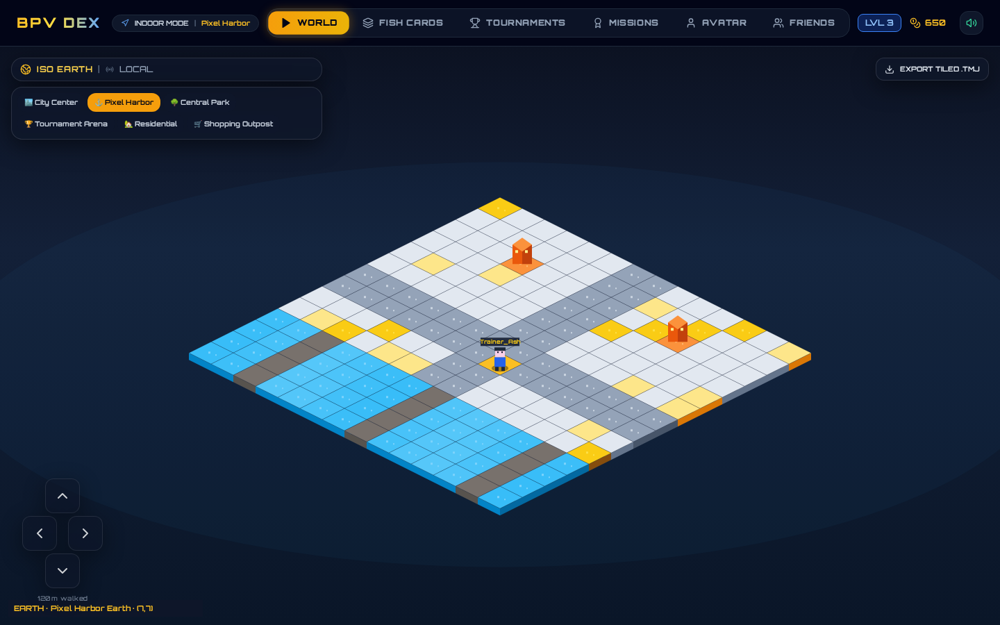
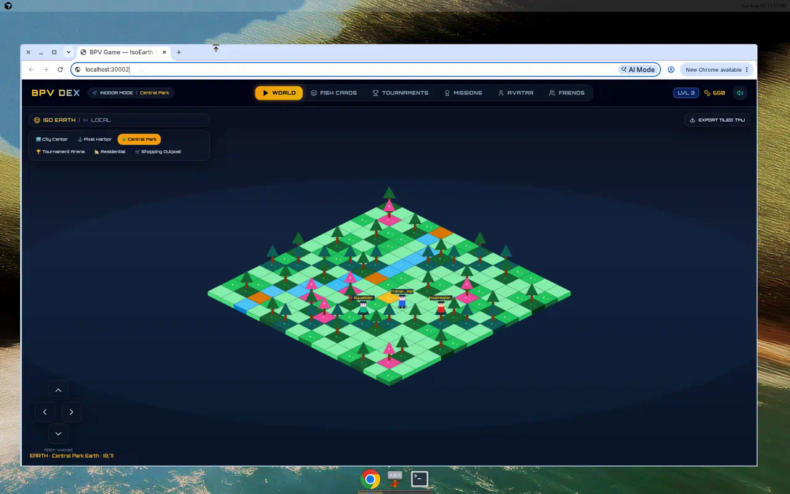

# Battle Pixel V — Web Base

Foundation for **BPV Game**: a scalable online 16-bit top-down RPG where real-world exploration and online multiplayer meet collectible Fish Cards and tournaments.

## Feel

Classic 16-bit RPG + Real-world exploration + Online multiplayer + Tournaments + Collectible Fish Cards

## Gameplay preview

<video src="docs/media/bpv-gameplay.mp4" controls width="100%" poster="docs/media/isoearth-world.png">
  Your browser does not support the video tag. <a href="docs/media/bpv-gameplay.mp4">Download the playthrough</a>.
</video>

[Download playthrough video (MP4)](docs/media/bpv-gameplay.mp4)

### Screenshots

**IsoEarth — City Center**


**IsoEarth — Pixel Harbor**



**IsoEarth — Central Park (live play)**



**Emoji Design Fish Cards**


**Tournaments**


## Stack

| Pillar | Tech |
| --- | --- |
| Web playable prototype | React + Canvas IsoEarth |
| Native foundation | SpriteKit + Swift + Core Location (`ios/BPVGame`) |
| Maps | Tiled Map Editor (`.tmj`) + IsoEarth JSON |
| API | Express / Neon → production **bpvgame.com** |

IsoEarth drawing & map JSON are inspired by isometric builders such as [isomiddleearth](https://github.com/hasanharman/isomiddleearth).

## Quick start

```bash
npm install
npm run dev          # web client → http://localhost:3000
npm run server       # local API → http://localhost:3001
```

Set `VITE_BPV_API_URL=http://localhost:3001` to point the client at the local server.

### Capture README media

With the dev server running:

```bash
node scripts/capture-demo.mjs
```

Writes screenshots + `docs/media/bpv-gameplay.mp4`.

## Docs

See [docs/ARCHITECTURE.md](docs/ARCHITECTURE.md) for IsoEarth, Emoji Design Cards, Tiled maps, multiplayer presence, and iOS scaffolding.
