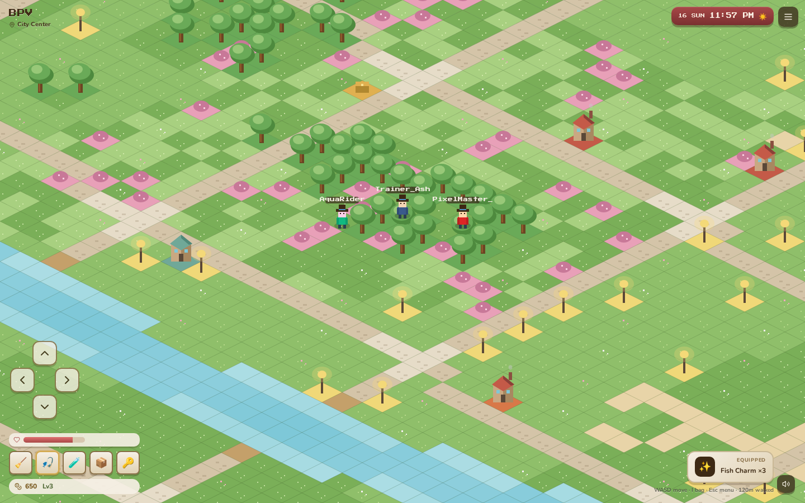
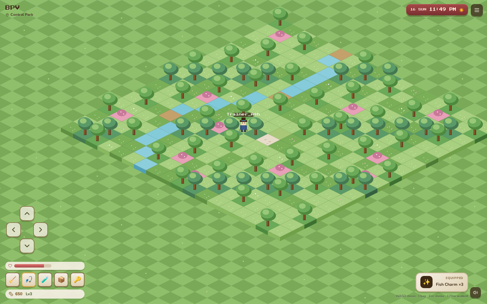
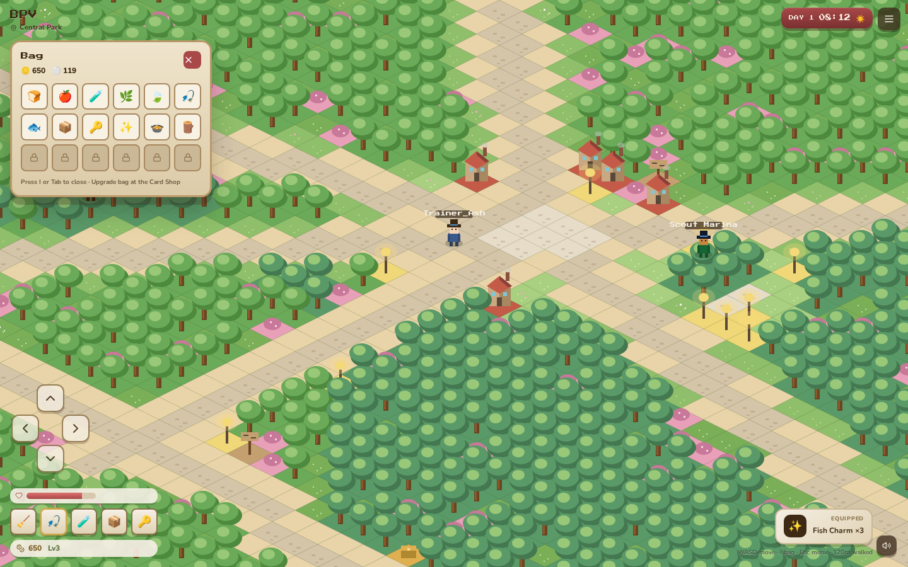
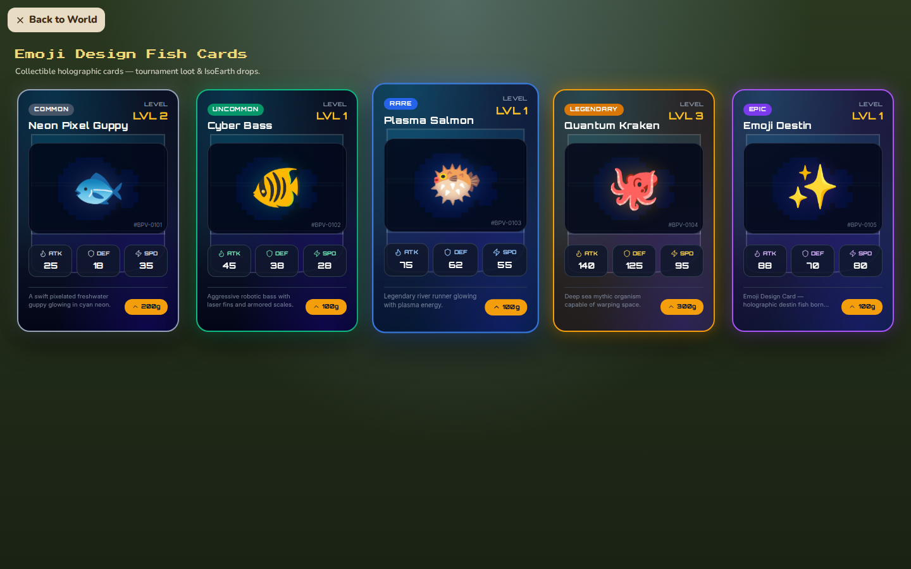
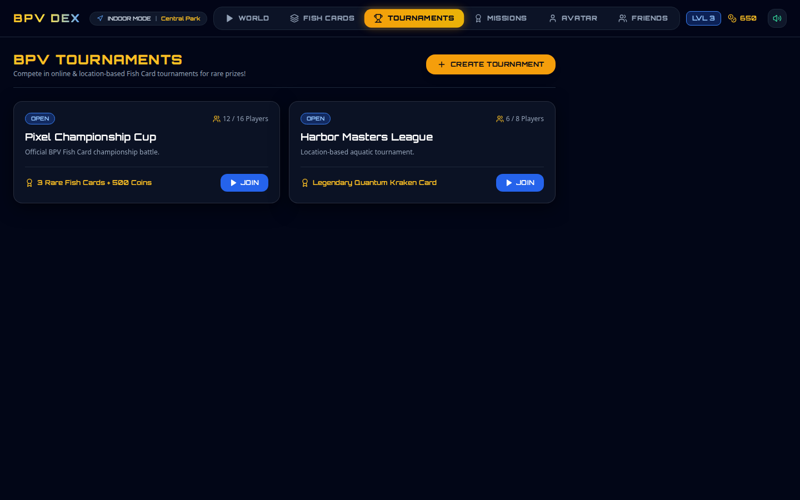

# Battle Pixel V — Web Base

Full-screen cozy **16-bit RPG** foundation for **BPV Game**: real-world exploration, online multiplayer, tournaments, and collectible Fish Cards.

## Feel

Classic 16-bit RPG + Real-world exploration + Online multiplayer + Tournaments + Collectible Fish Cards

## Gameplay preview

<video src="docs/media/bpv-gameplay.mp4" controls width="100%" poster="docs/media/isoearth-world.png">
  Your browser does not support the video tag. <a href="docs/media/bpv-gameplay.mp4">Download the playthrough</a>.
</video>

[Download playthrough video (MP4)](docs/media/bpv-gameplay.mp4)

### Screenshots

**Full-screen IsoEarth (City Center)**



**Central Park**



**Inventory bag (I / Tab)**



**Emoji Design Fish Cards**



**Tournaments**



### Controls

| Input | Action |
| --- | --- |
| Main menu | PLAY / ONLINE / OFFLINE / SERVERS / SETTINGS / EXIT |
| WASD / arrows / D-pad | Move (in world) |
| `E` / Space | Talk / listen |
| `I` or `Tab` | Open bag |
| `Esc` / ☰ | Pause menu (travel, Fish Cards, settings, leave world) |

## Stack

| Pillar | Tech |
| --- | --- |
| Web playable prototype | React + full-screen Canvas IsoEarth |
| Native foundation | SpriteKit + Swift + Core Location (`ios/BPVGame`) |
| Maps | Tiled Map Editor (`.tmj`) + IsoEarth JSON |
| API | Express / Neon → production **bpvgame.com** |

IsoEarth drawing & map JSON are inspired by isometric builders such as [isomiddleearth](https://github.com/hasanharman/isomiddleearth).

## Quick start

```bash
npm install
npm run dev          # web client → http://localhost:3000
npm run server       # API + dedicated game shard → :3001
npm run game-server  # alias of server (server.config.json)
```

Offline play does not require the server. Online / Servers uses `/api/game/*` (proxied from Vite).

```bash
npm run test:gate      # GameGate + dedicated-server authority
```

Set `VITE_BPV_API_URL=http://localhost:3001` to point the client at the local server.

### Capture README media

```bash
npm run capture:demo
```

## Docs

See [docs/ARCHITECTURE.md](docs/ARCHITECTURE.md) for IsoEarth, Emoji Design Cards, Tiled maps, multiplayer presence, and iOS scaffolding.
